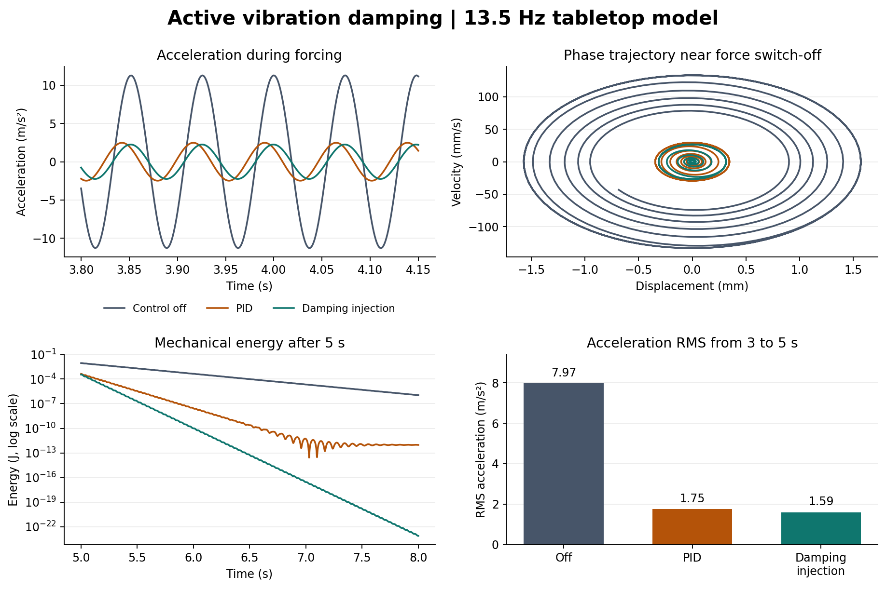

# 탁상용 능동 진동 저감 장치 시뮬레이션

스프링과 댐퍼로 지지한 상판에 고유진동수와 같은 13.5 Hz의 외란을 가하고, 제어를 끈 경우와 디지털 PID, 속도 비례 감쇠 주입을 비교했다. 외란이 작용하는 동일한 3–5초 구간에서 가속도 RMS는 **7.969 m/s²**에서 각각 **1.753 m/s²**와 **1.590 m/s²**로 줄었다. 입력과 센서 신호는 물리 모델에서 생성했다.



## 시스템 개요 및 하드웨어 구성

상판의 수직 변위와 속도를 한 축으로 모델링했다. 외란이 상판을 흔들면 가상의 제어기가 평형 위치를 기준으로 힘을 계산하고, 액추에이터 모델이 상판에 그 힘을 가한다.

| 개념 설계의 부품 | 시뮬레이션에서의 역할 |
|---|---|
| 상판과 스프링 지지대 | 상판 질량 1 kg, 등가 스프링 상수 약 7,195 N/m, 수동 감쇠 계수 3 N·s/m를 적용한다. |
| MPU6050 가속도 센서 | 수직 가속도에 중력 오프셋과 표준편차 0.05 m/s²의 가우스 잡음을 더해 가상 관측값을 만든다. |
| Arduino Nano | 1 ms마다 PID 또는 감쇠 주입 제어력을 계산하는 디지털 제어기를 나타낸다. |
| TB6612FNG 드라이버와 보이스 코일 | 드라이버가 전류 방향을 바꾸고 보이스 코일이 상판에 힘을 가하는 구성을 가정한다. 모델에서는 제어력의 부호가 방향을 정하며 최대 크기는 0.8 N이다. |

제어기는 모델의 변위와 속도를 직접 읽는다. 가상 MPU6050 신호는 관측값으로 분리하고, 성능 비교에는 운동 방정식에서 구한 가속도를 사용한다. 실제 센서로 피드백을 구성하려면 변위와 속도의 추정, 드라이버 지연, 코일의 전류–힘 특성을 별도로 검증해야 한다.

## 알고리즘 및 수학적 모델

수직 변위 $z$는 중력이 작용하는 정적 평형점을 기준으로 한다. 운동 방정식은 다음과 같다.

$$m\ddot z + c\dot z + kz = F_d(t)+u(t), \qquad k = m(2\pi f_0)^2.$$

$m=1\,\mathrm{kg}$, $f_0=13.5\,\mathrm{Hz}$, $c=3\,\mathrm{N\cdot s/m}$이다. 세 방식 모두 정지 상태에서 출발하며, 0초부터 5초까지 같은 0.4 N 진폭의 사인파 외란을 받는다. 5초에 외란을 끄고 8초까지 응답을 계산한다. 제어력은 각 1 ms 간격 동안 유지하고 상판의 운동은 4차 룽게–쿠타 방법으로 적분한다.

| 모드 | 제어력 |
|---|---|
| 제어 OFF | $u=0$. 수동 댐퍼만 에너지를 소산한다. |
| 디지털 PID | 오차 $e=-z$, 미분항 $\dot e=-\dot z$에 대해 $u=K_pe+K_i\sum e\Delta t+K_d\dot e$. 이득은 $K_p=800\,\mathrm{N/m}$, $K_i=120\,\mathrm{N/(m\cdot s)}$, $K_d=7\,\mathrm{N\cdot s/m}$이다. |
| 감쇠 주입 | $u=-K_v\dot z$, $K_v=12\,\mathrm{N\cdot s/m}$. 샘플 시점에 속도 반대 방향으로 힘을 건다. |

제어력은 ±0.8 N으로 제한한다. PID에서는 새 오차가 포화를 심화시키는 방향이면 해당 샘플의 적분 갱신을 건너뛴다.

상판의 기계적 에너지는 $H=\tfrac{1}{2}m\dot z^2+\tfrac{1}{2}kz^2$이다. 운동 방정식에 속도를 곱하면 다음 에너지 수지가 나온다.

$$\dot H=F_d\dot z+u\dot z-c\dot z^2.$$

이상적인 연속 시간 감쇠 주입에서는 $F_d=0$일 때 $\dot H=-(c+K_v)\dot z^2\le 0$이다. 외란이 가하는 일은 에너지를 늘릴 수 있고, 디지털 제어에서는 샘플 사이에 속도 방향이 바뀔 수 있다. 따라서 이 결과에서는 외란이 끝나는 5초와 시뮬레이션이 끝나는 8초의 에너지를 비교한다.

## 시뮬레이션 결과

동일 구간 $3\le t<5$초의 가속도에서 $a_{\mathrm{RMS}}=\sqrt{\sum a_i^2/n}$을 계산했다. 저감률은 $100(1-a_{\mathrm{RMS}}/a_{\mathrm{RMS,OFF}})$이다.

| 방식 | 가속도 RMS (m/s²) | OFF 대비 저감률 | 5초 에너지 (J) | 8초 에너지 (J) |
|---|---:|---:|---:|---:|
| 제어 OFF | 7.969 | 0.00% | 8.879 × 10⁻³ | 1.094 × 10⁻⁶ |
| 디지털 PID | 1.753 | 78.01% | 4.299 × 10⁻⁴ | 9.488 × 10⁻¹³ |
| 감쇠 주입 | 1.590 | 80.04% | 3.558 × 10⁻⁴ | 7.781 × 10⁻²⁴ |

위상 그래프에서 두 제어 방식 모두 OFF보다 작은 변위와 속도 범위를 보였다. PID의 에너지 곡선 끝부분에는 적분항의 느린 잔류 응답이 남는다. 감쇠 주입 방식의 8초 값은 이상화된 모델의 수치 결과다. 상세 수치는 [요약 CSV](results/summary.csv)에 있다.

## 실행 및 재현

Python 3.12 환경에서 저장소 폴더를 열고 실행한다.

```bash
python -m pip install -r requirements.txt
python simulate.py --output-dir results
```

`results/overview.png`와 `results/summary.csv`가 생성된다. 가상 센서 잡음의 시드는 42이며, 세 제어 방식에 같은 잡음 실현값을 적용한다.

## 바이브 코딩 프롬프트 시퀀스

1. 질량–스프링–댐퍼의 운동 방정식과 제어 OFF 기준을 구현하고 실행했다.
2. 같은 외란을 유지한 채 PID와 감쇠 주입을 추가하고, RMS·에너지·힘 포화를 비교했다.
3. 그래프와 요약 CSV를 재생성하는 명령을 만들고, 결과와 모델의 적용 조건을 정리했다.

단계별 요청과 확인 결과는 [프롬프트 기록](PROMPTS.md)에 정리했다.

## 참고 자료

- 강제 진동의 운동 방정식과 고유진동수 부근 응답. [OpenStax University Physics Volume 1 15.6 Forced Oscillations](https://openstax.org/books/university-physics-volume-1/pages/15-6-forced-oscillations)
